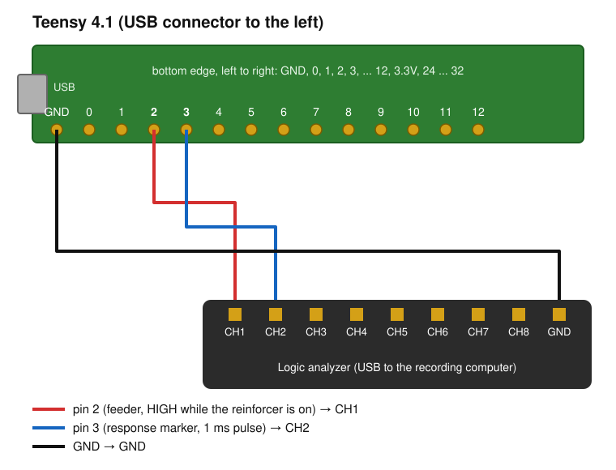

# contingency-bench

:gb: [English README](README.md)

contingency-bench は、大規模言語モデル (LLM) が並立変動時隔 (VI) スケジュールの 2 つの選択肢をどう選ぶかを測り、その選択を一般化マッチング法則でまとめます。動物と同じ言葉、つまり強化への感度・偏好 (バイアス)・参照用の学習モデルの 1 つのパラメータで LLM の選択行動を記述したい研究者に向けたものです。[OperantKit](https://github.com/OperantKit) の中では、LLM を被験体としたベンチマークを担います。また、ハードウェアを組み込んだ (HIL: hardware-in-the-loop) 計時ベンチとして、Teensy 4.1 で動く偽のオペラント箱のファームウェア、それを OperantKit のセッションで回すホスト側の実行の道具、ロジックアナライザの記録の解析を持ちます。

- **偏りの少ない指標で感度を出す。** 総反応だけでなく、強化されなかった反応にも当てはめます。
- **どの条件も試行数が同じ。** 差が経験量の差にならないようにします。
- **オフラインで動く。** LLM の代わりに模擬被験体を使えるので、API キーなしで手順全体を確かめられます。

## インストール

Python 3.11 以上。contingency-bench はまだ PyPI に公開されていないので、GitHub から入れます。依存する numpy と scipy は PyPI から入ります。

```bash
pip install git+https://github.com/OperantKit/contingency-bench
```

Claude のモデルに問い合わせるときは、Anthropic SDK も入れて `ANTHROPIC_API_KEY` を設定します。

```bash
pip install anthropic
```

## 例

LLM の代わりに模擬被験体 (`beta = 0.2` の方策圧縮の学習者) で手順全体を走らせます。API キーは要りません。

```python
import numpy as np
from contingency_bench import run_benchmark

np.random.seed(0)  # 模擬セッションは numpy の大域の乱数生成器から引く
results = run_benchmark(["mock-subject"], use_mock=True, steps_per_condition=200,
                        mock_betas={"mock-subject": 0.2})
r = results[0]
print(round(r.sensitivity_unreinforced, 2), round(r.sensitivity_total, 2), round(r.bias, 2), round(r.estimated_beta, 2))
# 0.38 0.82 -0.18 0.17
```

4 つの値は、強化されなかった反応に当てはめた一般化マッチング法則の感度、総反応に当てはめた感度、偏好 (log b)、1 つ目の感度から推定し直した `beta` です。推定された 0.17 は、模擬被験体に与えた 0.2 に近い値です。

## 仕組み

1. **セッション。** ボタンは 2 つです。試行ごとに、まだ強化が設定されていないボタンが、それぞれの確率で設定されます。設定されたボタンへの反応は強化され、設定は解除されます。設定の確率が (0.1, 0.9)、(0.3, 0.7)、(0.5, 0.5)、(0.7, 0.3)、(0.9, 0.1) の 5 条件を走らせます。
2. **被験体。** LLM は試行ごとに、試行番号とボタンごとのそれまでの反応数・強化数を書いた短い日本語のプロンプトを受け取り、`1` か `2` で答えます。模擬被験体は方策圧縮の学習者です (Lai & Gershman, 2021)。
3. **当てはめ。** 一般化マッチング法則 (Baum, 1974) を 5 条件にわたって 2 通りに当てはめます。強化されなかった反応の比と、総反応の比です。強化が頻繁なとき、総反応は感度を上に偏らせます (Davison, 2021)。
4. **参照モデル。** `estimate_beta_from_sensitivity` は、当てはめた感度に最も近い感度を出す方策圧縮の学習者の `beta` を探します。これで結果を 1 つのパラメータで言えます。

| 名前 | 中身 |
|---|---|
| `run_benchmark`、`run_condition` | 1 つ以上の被験体で全条件を走らせる／1 条件を走らせる |
| `ConcurrentVISession` | 2 つのボタンのセッション |
| `MockLLMClient`、`APILLMClient`、`BaseLLMClient` | 模擬被験体、Anthropic API 経由の Claude のモデル、自作のクライアントのための基底クラス |
| `PolicyCompressionAgent` | 参照用の学習者 |
| `estimate_matching_parameters`、`estimate_beta_from_sensitivity` | マッチング法則の当てはめと `beta` の探索 |
| `equate_training_steps` | どの条件にも同じ試行数を割り当てる |

コマンドラインでも同じ手順を走らせられます: `contingency-bench --mock --steps 50`。`--mock` を付けないと API を呼びます。`--model` (複数回指定可) で Claude のモデル ID を選びます。`--mock` のときの既定のモデル名は、`beta` の違う模擬被験体に付けた名前にすぎません。

## 制限

- **セッションは時間でなく試行で進みます。** ここでの「VI」は試行ごとの一定の設定確率のことで、秒単位の強化間間隔も、切り替え遅延 (COD) も、Fleshler–Hoffman の値もありません。実験箱のセッションのモデルではありません。
- **ボタンは 2 つ、条件は 5 つだけ**です。自分の `conditions` を渡さない限りコードで固定です。
- **組み込みは Anthropic のモデルだけ**です。他のモデルには `BaseLLMClient` のサブクラスが要ります。
- **失敗した呼び出しは無作為の選択になります。** API の呼び出しが失敗したとき (警告がログに出ます) や、答えに `1` と `2` の両方が含まれるか、どちらも含まれないとき (何もログに出ません)、その試行は無作為に答えられます。そうなった試行の数は報告されません。
- **実機の実行の道具は、操作体 1 つ・給餌器 1 つです。** 偽のオペラント箱がそうだからです。並立スケジュールはつないでいません。
- **`--realtime` は macOS だけで、効く保証はありません。** 時間制約スレッドは管理者権限なしで取れますが、計算時間を超えて動き続けたスレッドはカーネルが標準のポリシーへ戻します。macOS 以外では何もせず、実行はそのまま続きます。

## 実機 (Teensy 4.1)

`firmware/teensy41/` は [Teensy 4.1](https://www.pjrc.com/store/teensy41.html) で動く偽のオペラント箱です。模擬の被験体が 300 ms ごとに反応し、基板は experiment-io の serial backend (`SerialOperandum` / `SerialReinforcer`) と同じ 1 行 1 JSON の取り決めで話すので、ホストのセッションを本物の USB シリアルで回せます。2 本の端子をロジックアナライザで記録すると、反応から強化子までの遅れを確かめられます。

### 配線

Teensy からロジックアナライザへの線は 3 本です。

| Teensy 4.1 | ロジックアナライザ | 信号 |
|---|---|---|
| 2 番 | CH1 | 給餌器: 強化子の提示中は HIGH |
| 3 番 | CH2 | 反応の目印: 反応ごとに 1 ms の HIGH パルス |
| GND | GND | 共通のグラウンド |



USB 端子を左に向けると、下の辺の端子は左から GND、0、1、2、3、…、12 です。Teensy とアナライザは別々のパソコンにつないでもかまいません。その場合、GND の線で 2 台のパソコンのグラウンドがつながります。

### 書き込み

[PlatformIO](https://platformio.org/) を入れた環境で:

```bash
cd firmware/teensy41
pio run              # ビルドのみ
pio run -t upload    # ビルドして書き込む（teensy-cli）
```

### シリアルの取り決め

USB シリアルの上で、両方向とも 1 行に JSON を 1 つ送ります。

| 向き | 行 | 意味 |
|---|---|---|
| 機器 → ホスト | `{"op":0,"ts":<s>,"kind":"response","seq":<n>}` | 操作体 0 への反応。`ts` は最後の `sync` で渡されたホストの時計での秒、`seq` は 0 から数える |
| ホスト → 機器 | `{"cmd": "reinforcer", "op": 0, "duration": <s>}` | 給餌器 (2 番) を `duration` 秒 ON にする (無ければ 0.5) |
| ホスト → 機器 | `{"cmd":"sync","t":<s>}` | 反応を始める。`t` はいまのホストの時計で、以後の `ts` は `t` に Teensy の経過時間を足した値。遅れの記録を消す |
| ホスト → 機器 | `{"cmd":"stop"}` | 反応を止める |
| ホスト → 機器 | `{"cmd":"report"}` | `{"kind":"report","n":<n>,"lat_us":[...]}` を返す。強化子の命令ごとに、直前の反応から命令が届くまでのマイクロ秒 (最大 2000 件) |
| ホスト → 機器 | `{"cmd":"proto","p":"rs","duration":<s>}` | セッションの行を [contingency-rs](https://github.com/OperantKit/contingency-rs) のシリアル接続の形式 (下記) に切り替える。`D` の行で給餌器を `duration` 秒 ON にする (指定するまでは 0.05)。`{"cmd":"proto","p":"json"}` で戻す |

`proto rs` の後は、反応は `R 0` の行になり、機器は `D <channel> <magnitude>` を強化子の命令として受け取ります (`sync`・`stop`・`report`・`proto` は JSON のまま)。report は両方の形式で同じに測るので、同じ基板で Python のホストと Rust のホストを比べられます。`R` の行は機器の時刻を持ちません。

模擬の被験体は、給餌器が ON の間は反応しません。次の反応は前の反応の 300 ms 後です。

### ホスト側の実行

`contingency-bench-hil-crf` は、基板に対して OperantKit のセッションを回します。DSL の式を contingency-py のスケジュールに渡し、session-runner の `SessionRunner` が OKL のログを書き、experiment-io の `drive` がホストの単調増加の時計でシリアルポートから反応を読み、強化子の命令を送ります。`hil` の追加依存 (pyserial と OperantKit のパッケージ。`drive` が `on_response` を受け付ける版) が要ります。

```bash
pip install "contingency-bench[hil] @ git+https://github.com/OperantKit/contingency-bench"
contingency-bench-hil-crf --port /dev/cu.usbmodemXXXX --dsl CRF --reinforcers 200 \
    --duration 0.05 --okl run.okl --summary host.json
```

| オプション | 意味 |
|---|---|
| `--dsl` | contingency-dsl の式 (既定 `CRF`) |
| `--reinforcers` | この回数の強化子でセッションを終える (既定 200) |
| `--duration` | 強化子の長さ (秒)。強化子の命令ごとに送る (既定 0.05) |
| `--okl` / `--summary` | OKL のログ／要約の JSON を書く |
| `--max-duration` | この秒数で打ち切る (既定 600) |
| `--realtime` | ホストのループを macOS の時間制約スレッドで回す (experiment-io の `time_constraint`、周期 = 1 ms の poll 間隔)。適用できたかは要約の `realtime` に残る |

セッションの前に機器を止めて受信の溜まりを捨て、`sync` で模擬の被験体を動かし始めます。セッションの時刻はホストの時計です。反応ごとに、`drive` がセッションに渡す瞬間の時刻を付け、機器の時刻は記録として残します。セッションの後、機器をもう一度止めて `report` を受け取ります。`drive` はポートを閉じるので、そのためにもう一度開きます。要約の JSON には `finished`・`n_reinforcers`・`n_responses`・`elapsed_s`・`host_minus_device_ms` (反応ごとの、受け取った時刻 − 機器の `ts`。2 つの時計は `sync` でしかつながっていないので、伝送の遅れに一定のずれが足された値) と、`"device"` の下に機器の report が入り、`contingency-bench-hil-latency --device-report` がそれを読みます。強化子の回数に届かなかったとき、または機器が report を返さなかったとき、終了コードは 1 です。同じ実行は `contingency_bench.hil_crf` の `run_crf` でも使えます。

同じ CRF のセッションは、contingency-rs の `contingency-hil-serial` バイナリで Rust からも回せます (`cargo run --release --features serial --bin contingency-hil-serial -- --port /dev/cu.usbmodemXXXX --reinforcers 200 --duration 0.05 --summary host.json`)。`proto rs` で基板を切り替え、contingency-rs の CRF をシリアル接続で回し、同じキーの要約を書きます。こちらの `host_minus_device_ms` は空です。

### 遅れの解析

`contingency-bench-hil-latency` は `sigrok-cli -O vcd` が書いたロジックアナライザの記録を読み、反応の目印 (CH2) ごとに次の給餌器の立ち上がり (CH1) までの時間を数え、件数・中央値・p95・p99・最小・最大をマイクロ秒で出します。時間の単位は VCD の `$timescale` から読むので、1 MHz (`1 us`) と 4 MHz (`10 ns`) の記録が同じ単位になります。p95 と p99 は補間せず、記録された値のどれかを返します。

```bash
contingency-bench-hil-latency run.vcd --device-report report.json --expected-width 0.05
```

| オプション | 意味 |
|---|---|
| `--device-report` | 機器の `report` (`{"kind":"report","lat_us":[...]}`。そのままでも `"device"` の下でもよい) を含む JSON。反応ごとの差「アナライザ − 機器」を足す |
| `--expected-width` | 強化子の命令で送った `duration` (秒)。これと `--width-tolerance` (既定 0.0001 秒) より大きく違う給餌器のパルスを数え、警告に出す |
| `--response-signal` / `--feeder-signal` | sigrok の信号名 (既定 `D1` / `D0`。アナライザの CH2 / CH1) |
| `--json` | 要約と反応ごとの値を JSON で出す |

p95 と p99 には 95 % の信頼区間を付けます (表の `p95 95% CI`、JSON の `p95_ci` と `p99_ci`)。区間の両端は記録された値で、n 個の値のうち j 番目と k 番目に小さい値です。順位 j と k は B(k − 1) − B(j − 1) ≥ 0.95 を満たすように選びます。B は、試行 n 回・確率 0.95 または 0.99 の二項分布の累積分布関数です (Le Boudec, 2010, 定理 2.1)。分布の形は仮定しません。順位は、外れる確率が両側とも 2.5 % 以下になるように選びます。n が小さくて上側でそれができないときは、上端を最大値にし、5 % の残りを下側に回します。順位は整数なので、選んだ順位で決まる水準 (JSON の `coverage`) は、たいてい 0.95 より大きくなります。

区間が出るのは、p95 で 59 個以上、p99 で 299 個以上のときです。足りないときは区間を出さず (表は `-`、JSON は `null`)、要る個数を標準エラー出力と `interval_warnings` の警告で示します。この警告は終了コードを変えません。したがって強化子 200 回の実行では、p95 に区間が付き、p99 には付きません。

読み方: 遅れが 1 つの分布から互いに独立に出た値なら、この方法で作った区間の 95 % 以上が、その分布の p95 (または p99) を含みます。前の遅れに左右される遅れの列では成り立ちません (このコマンドは独立かどうかを検査しません)。また、区間は 1 回の実行についてのもので、実行・パソコン・基板による違いは含みません。

実行についての警告があると終了コードは 1 です。警告は、次の反応までに給餌器の立ち上がりが無い反応の目印、命令と違う給餌器の幅、反応の目印の数と長さが違う機器の report の 3 つです。給餌器の幅の誤りは、配線よりもファームウェアのパルスの終わりの計時が原因であることが多いので、まずファームウェアの出力を確かめてください。同じ解析は `contingency_bench.hil_latency` の `parse_vcd` と `analyze` でも使えます。

アナライザは別のパソコンにつないでかまいません (sigrok-cli は Windows でも動きます)。CH1 と CH2 の記録はセッションの数秒前に始め、セッションより少し長く取ります (0.05 秒の強化子 200 回の CRF は約 60 秒)。

```bash
sigrok-cli -d fx2lafw --config samplerate=1m --channels D0,D1 --time 100000 -O vcd -o run.vcd
```

`--time` はミリ秒です。VCD を解析するパソコンに写します。`-o` を付けないと sigrok-cli は VCD を標準出力に書くので、ホストから SSH で動かし、ホスト側のファイルに出力を向けることもできます。その場合、アナライザのパソコンには何も書きません。

### ホスト判定と機器判定の比較

`contingency-bench-hil-diff` は、同じ式を `contingency-bench-hil-crf --decision host` と `--decision device` で 1 回ずつ回した OKL のログ 2 本を比べます。模擬の被験体は一定の周期で反応しますが、給餌器が出ている間は反応しません。反応の予定の時刻に給餌器の動作が重ならない限り、2 本は同じ反応列になります。このコマンドは、ホスト (contingency-py) と機器 (contingency-rs) が同じ反応を強化したかを反応ごとに確かめます。

```bash
contingency-bench-hil-crf --port /dev/cu.usbmodemXXXX --decision host \
    --dsl '@algorithm("fleshler-hoffman", seed=7)
VI 30s' --reinforcers 10 --okl host.okl --summary host.json
contingency-bench-hil-crf --port /dev/cu.usbmodemXXXX --decision device \
    --dsl '@algorithm("fleshler-hoffman", seed=7)
VI 30s' --reinforcers 10 --okl device.okl --summary device.json
contingency-bench-hil-diff host.okl device.okl --host-summary host.json
```

| 行 | 意味 |
|---|---|
| A 反応数／反応の時刻の差 | 反応の数と、反応の `id` ごとの、セッションの原点からの時刻の差 (ミリ秒)。差が `--threshold-ms` (既定 1) を越えた最初の反応、または片方のログにしか無い最初の反応を、食い違いの位置として出す |
| B 判定の一致 | 食い違いの位置より前の反応のうち、2 本の判定 (強化／非強化) が一致した数と、一致しなかった反応の id |
| C 強化子数 | `reinforcer_start` の行の数 |
| D 強化の時刻の差 | 2 本とも強化した反応について、原点からの強化の時刻の差 (ホスト − 機器、ミリ秒)。件数・最小・中央値・p95・最大 |
| E 反応から強化までの遅れ | 機器は OKL から出す。ホストは `--host-summary` の機器の `lat_us` を使う。ホストのログは反応と強化子に同じ時刻を付けるので、ログからは出ない |
| F 強化子の長さ | `reinforcer_end − reinforcer_start` (ミリ秒) |

2 本のログは時計も原点も違います。ホストのログの原点は `state_change IDLE RUNNING` の行 (`sync` で送った時刻) で、反応の時刻は `device_time` を使います。機器のログの原点はヘッダの `session_start` です。反応の後、次の反応の前に `reinforcer_start` の行があれば、その反応は強化されたと数えます。反応列が食い違った後の判定は、もう同じ入力に対する判定ではないので、B と D は食い違いの位置より前の反応だけで出します。FT・VT・RT では給餌器がいつでも動きうるので、ホストの数ミリ秒の遅れで次の反応の時刻が動くことがあり、その場合は、そこまでの判定が一致していても終了コードは 1 になります。強化子は直前の反応に付けるので、間に反応の無い 2 回の強化子は B では 1 回と数えます。D にはホストへの伝送と 2 つの時計の差が含まれ、給餌器のピンで測った値ではありません。p95 は補間せず、記録された値のどれかを返します。

`--device-summary` を付けると、機器の E をその `lat_us` に置き換えます。`--json` で結果を JSON で出します。A・B・C のどれかが食い違うと終了コードは 1、1 本目が `decision = "host"` でない・2 本目が `decision = "device"` でない・2 本の `dsl` が違うときは 2 です。同じ比較は `contingency_bench.hil_diff` の `load_okl` と `compare` でも使えます。

### 既知の制約

- **macOS は、新しくつながったアクセサリごとに接続の許可を求めます。** Teensy をつなぎ直すたび (書き込み中の再接続を含む) に「アクセサリの接続を許可しますか」が出ることがあり、許可されるまで書き込みは `Operation not permitted` や `Unable to open device` で失敗します。出ないようにするには、システム設定 → プライバシーとセキュリティ → アクセサリ → 「アクセサリの接続を許可」を「ロック解除時に自動的に許可」にします ([Apple のサポート記事](https://support.apple.com/en-us/102282))。
- **時間切れになった書き込みは、`teensy_loader_cli` が基板をつかんだまま残ることがあります。** 次の書き込みの前に、残ったプロセス (`pgrep -fl teensy_loader`) を止めます。
- **Teensy の時計とホストの時計は合っていません。** `sync` で機器の原点をホストの時刻にそろえますが、その後は 2 つの時計を合わせ続けないので、ホストが命令を書いてから機器が受け取るまでの遅れは片側だけでは読めません。アナライザと機器の report が測るのは、機器の側で起きることだけです。

## レスポンデントの法則スイート

`tests/test_respondent_laws.py` は、パヴロフ型 (レスポンデント) の現象のうち、どれを Rescorla–Wagner モデル (Rescorla & Wagner, 1972) が予測するかを確かめます。contingency-respondent-dsl の Tier B の conformance の例 (`expected_ast`) を全部、contingency-respondent-py の展開器と session-analyzer の複合 CS の Rescorla–Wagner モデルに通し (全刺激 α = 0.3、β = 1、各 US の λ = 1、AST に回数が無い段階は 20 試行)、現象を連合強度 (V) の不等式だけで判定します。

スイートには extra の `respondent` (contingency-respondent-py と session-analyzer) が要ります。どちらもまだ PyPI に無いので、extra の前にそれぞれの checkout から入れます。入っていなければスイートを飛ばします。例の置き場は `$RESPONDENT_CONFORMANCE_ROOT`、無ければ `contingency-respondent-dsl/conformance/tier-b` を持つ祖先のディレクトリで、見つからなければスイートを飛ばします。

```bash
.venv/bin/python -m pip install -e <contingency-respondent-py> -e <session-analyzer>
.venv/bin/python -m pip install -e ".[respondent,test]"
.venv/bin/pytest tests/test_respondent_laws.py
```

- **通過** — R–W で現象の向きが出る。
- **通過・機構は違う** — 素直な拡張 (文脈を要素にする・US ごとに系を分ける) で向きは出るが、その手続きで知られる機構は出ない。
- **期待どおりの不一致** — R–W では現象が出ない。テストは現象を書き、`xfail(strict=True)` にしてある。
- **未対応** — CS 内の時間が要る。展開器が断る。

| # | 手続き | R–W | V での判定 | 結果 (スイートの値) |
|---|---|---|---|---|
| 1 | HigherOrderConditioning | しない | X→A の後に V_light > 0 | 期待どおりの不一致 (V_light = 0) |
| 2 | SensoryPreconditioning | しない | test で V_light > 0 | 期待どおりの不一致 (V_light = 0) |
| 3 | Counterconditioning | 部分 | V^shock_tone が下がり、V^food_tone > 0 | 通過・機構は違う (0.999 → 0.001、V^food 0.999)。US の系どうしの相互制止は無い |
| 4 | Blocking | する | V_x < 対照 | 通過 (0.000 対 0.500) |
| 5 | Overshadowing | する | V_dim < 単独訓練、V_loud > V_dim (α 0.5 / 0.2) | 通過 (0.286 対 1.000、V_loud 0.714) |
| 6 | Overexpectation | する | AX+ で V_a が下がり、対照は不変 | 通過 (0.999 → 0.500、対照 0.999) |
| 7 | SuperConditioning | する | V_x > 相手が中性刺激の対照 | 通過 (0.969 対 0.500、V_i −0.938) |
| 8 | RetrospectiveRevaluation | しない | 後向きブロッキング (V_x < 対照) と回復 (V_x > 対照) | 期待どおりの不一致 (2 例とも V_x = 対照 = 0.500) |
| 9 | ConditionedInhibition | する | V_i < 0 かつ V_a + V_i → 0 | 通過 (V_a 0.997、V_i −0.996)。記録された A+/AX− のデータ (下) にも弁別が出ている |
| 10 | OccasionSetting | 部分 | FP: V_feature > 0、V_target ≈ 0 | 通過・機構は違う (0.998 / 0.001)。場面設定そのものは要素の和では出ない |
| 11 | InhibitionOfDelay | しない | — | 未対応 |
| 12 | SummationRetardationTest | する | ΣV(E+I) < V_E、5 試行後の V_I < 新奇 CS | 通過 (0.001 対 0.997、0.664 対 0.832) |
| 13 | LatentInhibition | しない | 訓練後の V_tone < 対照 | 期待どおりの不一致 (1.000 = 1.000) |
| 14 | USPreexposure | 部分 | V_tone < 対照 | 通過・機構は違う (0.000 対 0.500)。文脈によるブロッキングだけ |
| 15 | Renewal | 部分 | ΣV (A での test) > ΣV (B での消去の終わり) | 通過・機構は違う (0.750 対 0.000)。文脈 B が制止子になって終わる |
| 16 | Reinstatement | 部分 | ΣV(test) > ΣV (消去の終わり)、別文脈では不変 | 通過・機構は違う (0.760 対 0.000)。文脈の興奮だけ |
| 17 | SpontaneousRecovery | しない | V_tone(test) > 消去の終わり | 期待どおりの不一致 (時間の変数が無い) |
| 18 | LatentExtinction | 部分 | ΣV(test) < 対照 | 通過・機構は違う (0.500 対 1.000)。減るのは文脈の分だけ |
| 19 | PavlovianPREE | しない | 消去後に V(部分) > V(連続) | 期待どおりの不一致 (R–W は逆を出す) |
| 20 | ContextualExtinction | 部分 | ΣV (獲得文脈での test) > 消去の終わり | 通過・機構は違う (0.750 対 0.000) |
| 21 | ReconsolidationInterference | しない | 普通の消去の後は回復し、想起→消去の後は回復しない | 期待どおりの不一致 (どちらも回復しない) |
| 22 | ConditionedTasteAversion | 部分 | 1 試行後に V_taste > 0 | 通過・機構は違う (0.300)。CS–US の遅延は捨てている |
| 23 | StimulusGeneralization | しない | V(750 Hz) > V(500 Hz) > 0 | 期待どおりの不一致 (訓練していない刺激は 0 のまま) |
| 24 | ContextualFearConditioning | 部分 | 1 試行後に V_ctx > 0 | 通過・機構は違う (0.300)。置いてから電撃までの間隔は捨てている |
| 25 | PeakProcedure | しない | — | 未対応 |
| 26 | MediatedConditioning | しない | V^lithium_flavor > 0 | 期待どおりの不一致 (V = 0) |

合計: 通過 6、通過・機構は違う 9、期待どおりの不一致 9、未対応 2 (例のファイルは 26。`RetrospectiveRevaluation` と
`SummationRetardationTest` は例が 2 つずつ)。

9 行目の記録データ: ラットの A+ / AX− 手続きを MED-PC で記録した公開データ (セッション番号の取れる 920 セッション) では、
CS 8 秒あたりの餌皿への進入が、AX− では A+ の 0.73 倍 (セッション 1–5) から 0.44 倍 (6–15)、0.20 倍 (16 以降) に下がり、
A+ は 10 前後のままでした。R–W が予測する弁別 (AX− の ΣV が V_A より小さい) と向きが合います。
このデータには X の加算検査・遅延検査はありません。

## AI のコーディングエージェント向け

AI のコーディングエージェント向けの案内は [AGENTS.md](AGENTS.md) にあります。

## 開発

```bash
python -m venv .venv
.venv/bin/python -m pip install -e ".[dev]"
.venv/bin/pytest
```

両方の README の `python` ブロックはすべて `tests/test_readme_examples.py` が実行します。

## 参考文献

- Baum, W. M. (1974). On two types of deviation from the matching law: Bias and undermatching. *Journal of the Experimental Analysis of Behavior, 22*(1), 231–242. https://doi.org/10.1901/jeab.1974.22-231
- Davison, M. (2021). Concurrent schedules: How responses per reinforcer affects estimates of sensitivity to reinforcement. *Journal of the Experimental Analysis of Behavior, 116*(1), 114–123. https://doi.org/10.1002/jeab.694
- Lai, L., & Gershman, S. J. (2021). Policy compression: An information bottleneck in action selection. *Psychology of Learning and Motivation, 74*, 195–232. https://doi.org/10.1016/bs.plm.2021.02.004
- Le Boudec, J.-Y. (2010). *Performance evaluation of computer and communication systems*. EPFL Press. https://infoscience.epfl.ch/record/146812
- Rescorla, R. A., & Wagner, A. R. (1972). A theory of Pavlovian conditioning: Variations in the effectiveness of reinforcement and nonreinforcement. In A. H. Black & W. F. Prokasy (Eds.), *Classical conditioning II: Current research and theory* (pp. 64–99). Appleton-Century-Crofts.

## ライセンス

MIT です。[LICENSE](LICENSE) を参照してください。
