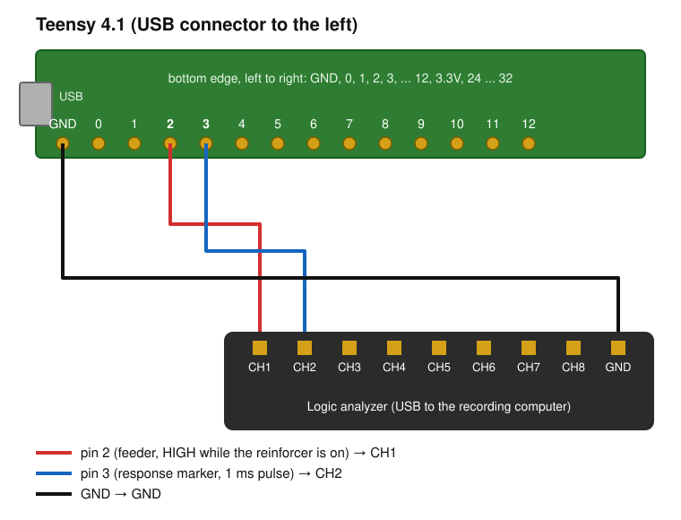

# contingency-bench

:jp: [日本語版 README](README.ja.md)

contingency-bench measures how a large language model (LLM) chooses between two options on concurrent variable-interval (VI) schedules, and summarizes its choices with the generalized matching law. It is for researchers who want to describe an LLM's choice behavior in the terms used for animals: sensitivity to reinforcement, bias, and one parameter of a reference learning model. Within [OperantKit](https://github.com/OperantKit), it is the benchmark for LLMs as subjects. It also holds a hardware-in-the-loop (HIL) timing bench: firmware for a fake operant chamber on a Teensy 4.1, a host-side runner that drives it with OperantKit sessions, and the analysis of logic-analyzer recordings.

- **Sensitivity from the less biased measure.** Fitted to unreinforced responses as well as to total responses.
- **Every condition gets the same number of trials,** so differences are not differences in exposure.
- **Runs offline.** A simulated subject stands in for the LLM, so you can check the pipeline without an API key.

## Installation

Python 3.11 or newer. contingency-bench is not on PyPI yet; install it from GitHub. Its dependencies, numpy and scipy, come from PyPI.

```bash
pip install git+https://github.com/OperantKit/contingency-bench
```

To query Claude models, also install the Anthropic SDK and set `ANTHROPIC_API_KEY`:

```bash
pip install anthropic
```

## Example

Run the whole procedure on the simulated subject (a policy-compression learner with `beta = 0.2`) instead of an LLM, so no API key is needed:

```python
import numpy as np
from contingency_bench import run_benchmark

np.random.seed(0)  # the simulated sessions draw from numpy's global generator
results = run_benchmark(["mock-subject"], use_mock=True, steps_per_condition=200,
                        mock_betas={"mock-subject": 0.2})
r = results[0]
print(round(r.sensitivity_unreinforced, 2), round(r.sensitivity_total, 2), round(r.bias, 2), round(r.estimated_beta, 2))
# 0.38 0.82 -0.18 0.17
```

The four values are the generalized-matching sensitivity fitted to unreinforced responses, the sensitivity fitted to total responses, the bias (log b), and the `beta` recovered from the first sensitivity. The recovered 0.17 is close to the simulated 0.2.

## How it works

1. **Session.** Two buttons. On every trial each button that is not already set up becomes set up with its own probability; a response on a set-up button is reinforced and resets it. Five conditions are run, with set-up probabilities (0.1, 0.9), (0.3, 0.7), (0.5, 0.5), (0.7, 0.3), and (0.9, 0.1).
2. **Subject.** On each trial an LLM gets a short Japanese prompt with the trial number and its responses and reinforcers so far on each button, and answers `1` or `2`. The simulated subject is a policy-compression learner (Lai & Gershman, 2021).
3. **Fit.** The generalized matching law (Baum, 1974) is fitted across the five conditions twice: to the ratio of unreinforced responses and to the ratio of total responses. Total responses bias the sensitivity upward when reinforcers are frequent (Davison, 2021).
4. **Reference model.** `estimate_beta_from_sensitivity` finds the `beta` of the policy-compression learner whose sensitivity is closest to the fitted one, so the result can be stated as one parameter.

| Name | What it is |
|---|---|
| `run_benchmark`, `run_condition` | Run all conditions for one or more subjects, or one condition |
| `ConcurrentVISession` | The two-button session |
| `MockLLMClient`, `APILLMClient`, `BaseLLMClient` | The simulated subject, a Claude model through the Anthropic API, and the base class for your own client |
| `PolicyCompressionAgent` | The reference learner |
| `estimate_matching_parameters`, `estimate_beta_from_sensitivity` | The matching-law fit and the `beta` lookup |
| `equate_training_steps` | Gives every condition the same number of trials |

The command line runs the same procedure: `contingency-bench --mock --steps 50`. Without `--mock` it calls the API; `--model` (repeatable) chooses the Claude model IDs. With `--mock`, the default model names are only labels for simulated subjects with different `beta` values.

## Limitations

- **The session is in trials, not in time.** "VI" here means a fixed set-up probability per trial; there are no inter-reinforcement intervals in seconds, no changeover delay, and no Fleshler–Hoffman values. It is not a model of a chamber session.
- **Only two buttons and five conditions,** fixed in the code unless you pass your own `conditions`.
- **Only Anthropic models** are built in. Other models need a subclass of `BaseLLMClient`.
- **Failed calls become random choices.** If the API call fails (a warning is logged), or the answer contains both `1` and `2` or neither (nothing is logged), the trial is answered at random. The number of such trials is not reported.
- **The hardware runner has one operandum and one feeder,** as the fake chamber has. Concurrent schedules are not wired to it.

## Hardware (Teensy 4.1)

`firmware/teensy41/` is a fake operant chamber for a [Teensy 4.1](https://www.pjrc.com/store/teensy41.html). A simulated subject responds every 300 ms, and the board speaks the line-delimited JSON of the experiment-io serial backend (`SerialOperandum` / `SerialReinforcer`), so a host session can run against real USB serial. Two pins can be recorded with a logic analyzer to check the latency from a response to the reinforcer.

### Wiring

Three wires from the Teensy to a logic analyzer:

| Teensy 4.1 | Logic analyzer | Signal |
|---|---|---|
| pin 2 | CH1 | Feeder: HIGH while the reinforcer is on |
| pin 3 | CH2 | Response marker: a 1 ms HIGH pulse at each response |
| GND | GND | Common ground |



With the USB connector to the left, the bottom row of pins is, from the left, GND, 0, 1, 2, 3, ... 12. The Teensy and the analyzer may be connected to different computers; the GND wire then joins the two computers' grounds.

### Build and upload

With [PlatformIO](https://platformio.org/) installed:

```bash
cd firmware/teensy41
pio run              # build only
pio run -t upload    # build and upload (teensy-cli)
```

### Serial protocol

One JSON object per line, in both directions, over USB serial.

| Direction | Line | Meaning |
|---|---|---|
| device → host | `{"op":0,"ts":<s>,"kind":"response","seq":<n>}` | A response on operandum 0. `ts` is in seconds on the host clock given by the last `sync`; `seq` counts from 0 |
| host → device | `{"cmd": "reinforcer", "op": 0, "duration": <s>}` | Turn the feeder (pin 2) on for `duration` seconds (0.5 if missing) |
| host → device | `{"cmd":"sync","t":<s>}` | Start responding. `t` is the host's clock now; later `ts` values are `t` plus the Teensy's elapsed time. Clears the latency log |
| host → device | `{"cmd":"stop"}` | Stop responding |
| host → device | `{"cmd":"report"}` | Reply `{"kind":"report","n":<n>,"lat_us":[...]}`: for each reinforcer command, the microseconds from the response it followed to its arrival (up to 2000) |

The simulated subject does not respond while the feeder is on. The next response comes 300 ms after the previous one.

### Host-side run

`contingency-bench-hil-crf` runs an OperantKit session against the board: the DSL expression is bridged to a contingency-py schedule, a session-runner `SessionRunner` writes the OKL log, and experiment-io `drive` reads responses and sends reinforcer commands over the serial port with the host's monotonic clock. It needs the `hil` extra (pyserial and the OperantKit packages; `drive` must accept `on_response`).

```bash
pip install "contingency-bench[hil] @ git+https://github.com/OperantKit/contingency-bench"
contingency-bench-hil-crf --port /dev/cu.usbmodemXXXX --dsl CRF --reinforcers 200 \
    --duration 0.05 --okl run.okl --summary host.json
```

| Option | Meaning |
|---|---|
| `--dsl` | contingency-dsl expression (default `CRF`) |
| `--reinforcers` | End the session after this many reinforcers (default 200) |
| `--duration` | Reinforcer duration in seconds, sent in each reinforcer command (default 0.05) |
| `--okl` / `--summary` | Write the OKL log / the summary JSON |
| `--max-duration` | Give up after this many seconds (default 600) |

Before the session the device is stopped and the input buffer cleared; `sync` then starts the simulated subject. Session time is the host clock: each response is stamped when `drive` hands it to the session, and the device's own time is kept as a record. After the session the device is stopped again and its `report` fetched; `drive` closes the port, so it is opened once more for that. The summary JSON holds `finished`, `n_reinforcers`, `n_responses`, `elapsed_s`, `host_minus_device_ms` (receipt time minus the device's `ts` for each response; the two clocks are only joined by `sync`, so this is the transmission delay plus a fixed offset) and the device report under `"device"`, which `contingency-bench-hil-latency --device-report` reads. The command exits with 1 if the session did not reach the reinforcer count or the device did not report. The same run is available as `run_crf` in `contingency_bench.hil_crf`.

### Latency analysis

`contingency-bench-hil-latency` reads a logic-analyzer recording written by `sigrok-cli -O vcd` and prints, for each response marker (CH2), the time to the next feeder rising edge (CH1): count, median, p95, p99, minimum and maximum, in microseconds. The time unit is taken from the VCD's `$timescale`, so recordings at 1 MHz (`1 us`) and 4 MHz (`10 ns`) give the same unit. p95 and p99 are recorded values, not interpolated.

```bash
contingency-bench-hil-latency run.vcd --device-report report.json --expected-width 0.05
```

| Option | Meaning |
|---|---|
| `--device-report` | JSON holding the device's `report` (`{"kind":"report","lat_us":[...]}`, bare or under `"device"`). Adds the per-response difference "analyzer − device" |
| `--expected-width` | The `duration` sent in the reinforcer command, in seconds. Feeder pulses that differ from it by more than `--width-tolerance` (default 0.0001 s) are counted and shown in a warning |
| `--response-signal` / `--feeder-signal` | sigrok signal names (default `D1` / `D0`, which are analyzer CH2 / CH1) |
| `--json` | Print the summary and the per-response values as JSON |

The command exits with 1 when there is a warning: a response marker with no feeder edge before the next response, a feeder width that differs from the command, or a device report whose length differs from the number of response markers. A wrong feeder width is more often the firmware's timing of the pulse end than the wiring; check the firmware output first. The same analysis is available as `parse_vcd` and `analyze` in `contingency_bench.hil_latency`.

The analyzer can be on another computer (sigrok-cli also runs on Windows). Start recording CH1 and CH2 a few seconds before the session and record a little longer than it lasts (a CRF session of 200 reinforcers of 0.05 s takes about 60 s):

```bash
sigrok-cli -d fx2lafw --config samplerate=1m --channels D0,D1 --time 100000 -O vcd -o run.vcd
```

`--time` is in milliseconds. Copy the VCD to the computer that runs the analysis. Without `-o`, sigrok-cli writes the VCD to standard output, so it can also be run over SSH from the host and redirected to a local file there; nothing is then written on the analyzer's computer.

### Known constraints

- **macOS asks to allow each new accessory connection.** Each time the Teensy is plugged in again (including the re-enumeration during an upload), macOS may show "Allow accessory to connect?". Until it is allowed, uploading fails with `Operation not permitted` or `Unable to open device`. To avoid the prompt, set System Settings → Privacy & Security → Accessories → "Allow accessories to connect" to "Automatically allow when unlocked" ([Apple Support](https://support.apple.com/en-us/102282)).
- **A timed-out upload can leave `teensy_loader_cli` holding the board.** Stop the leftover process (`pgrep -fl teensy_loader`) before the next upload.
- **The Teensy's clock and the host's are not aligned.** `sync` sets the device's origin to the host's time, the two clocks are not kept together after that, and the latency from the host writing a command to the device receiving it cannot be read from one side. The analyzer and the device report measure only what happens at the device.

## For AI coding agents

Guidance for AI coding agents is in [AGENTS.md](AGENTS.md).

## Development

```bash
python -m venv .venv
.venv/bin/python -m pip install -e ".[dev]"
.venv/bin/pytest
```

Every `python` block in both READMEs is run by `tests/test_readme_examples.py`.

## References

- Baum, W. M. (1974). On two types of deviation from the matching law: Bias and undermatching. *Journal of the Experimental Analysis of Behavior, 22*(1), 231–242. https://doi.org/10.1901/jeab.1974.22-231
- Davison, M. (2021). Concurrent schedules: How responses per reinforcer affects estimates of sensitivity to reinforcement. *Journal of the Experimental Analysis of Behavior, 116*(1), 114–123. https://doi.org/10.1002/jeab.694
- Lai, L., & Gershman, S. J. (2021). Policy compression: An information bottleneck in action selection. *Psychology of Learning and Motivation, 74*, 195–232. https://doi.org/10.1016/bs.plm.2021.02.004

## License

MIT. See [LICENSE](LICENSE).
