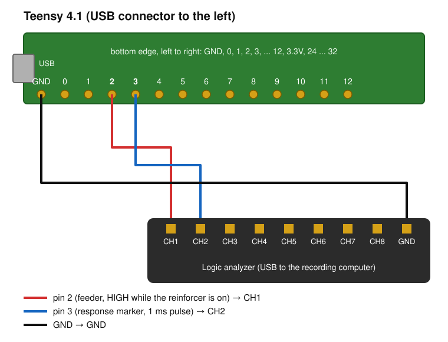

# contingency-bench

:jp: [日本語版 README](README.ja.md)

contingency-bench measures how a large language model (LLM) chooses between two options on concurrent variable-interval (VI) schedules, and summarizes its choices with the generalized matching law. It is for researchers who want to describe an LLM's choice behavior in the terms used for animals: sensitivity to reinforcement, bias, and one parameter of a reference learning model. Within [OperantKit](https://github.com/OperantKit), it is the benchmark for LLMs as subjects. It also holds a hardware-in-the-loop (HIL) timing bench: firmware for a fake operant chamber on a Teensy 4.1, a host-side runner that drives it with OperantKit sessions, and the analysis of logic-analyzer recordings.

- **Sensitivity from the less biased measure.** Fitted to unreinforced responses as well as to total responses.
- **Every condition gets the same number of trials,** so differences are not differences in exposure.
- **Runs offline.** A simulated subject stands in for the LLM, so you can check the pipeline without an API key.

## Installation

Python 3.11 or newer. contingency-bench is not on PyPI yet; install it from GitHub. Its dependencies, numpy and scipy, come from PyPI. The `hil` extra also needs six OperantKit packages that are not on PyPI; [Host-side run](#host-side-run) shows how to install them from GitHub.

```bash
pip install git+https://github.com/OperantKit/contingency-bench
```

To query Claude models, also install the Anthropic SDK and set `ANTHROPIC_API_KEY`:

```bash
pip install anthropic
```

## Example

Run the whole procedure on the simulated subject (a policy-compression learner with `beta = 0.2`) instead of an LLM, so no API key is needed:

```python
import numpy as np
from contingency_bench import run_benchmark

np.random.seed(0)  # the simulated sessions draw from numpy's global generator
results = run_benchmark(["mock-subject"], use_mock=True, steps_per_condition=200,
                        mock_betas={"mock-subject": 0.2})
r = results[0]
print(round(r.sensitivity_unreinforced, 2), round(r.sensitivity_total, 2), round(r.bias, 2), round(r.estimated_beta, 2))
# 0.38 0.82 -0.18 0.17
```

The four values are the generalized-matching sensitivity fitted to unreinforced responses, the sensitivity fitted to total responses, the bias (log b), and the `beta` recovered from the first sensitivity. The recovered 0.17 is close to the simulated 0.2.

## How it works

1. **Session.** Two buttons. On every trial each button that is not already set up becomes set up with its own probability; a response on a set-up button is reinforced and resets it. Five conditions are run, with set-up probabilities (0.1, 0.9), (0.3, 0.7), (0.5, 0.5), (0.7, 0.3), and (0.9, 0.1).
2. **Subject.** On each trial an LLM gets a short Japanese prompt with the trial number and its responses and reinforcers so far on each button, and answers `1` or `2`. The simulated subject is a policy-compression learner (Lai & Gershman, 2021).
3. **Fit.** The generalized matching law (Baum, 1974) is fitted across the five conditions twice: to the ratio of unreinforced responses and to the ratio of total responses. Total responses bias the sensitivity upward when reinforcers are frequent (Davison, 2021).
4. **Reference model.** `estimate_beta_from_sensitivity` finds the `beta` of the policy-compression learner whose sensitivity is closest to the fitted one, so the result can be stated as one parameter.

| Name | What it is |
|---|---|
| `run_benchmark`, `run_condition` | Run all conditions for one or more subjects, or one condition |
| `ConcurrentVISession` | The two-button session |
| `MockLLMClient`, `APILLMClient`, `BaseLLMClient` | The simulated subject, a Claude model through the Anthropic API, and the base class for your own client |
| `PolicyCompressionAgent` | The reference learner |
| `estimate_matching_parameters`, `estimate_beta_from_sensitivity` | The matching-law fit and the `beta` lookup |
| `equate_training_steps` | Gives every condition the same number of trials |

The command line runs the same procedure: `contingency-bench --mock --steps 50`. Without `--mock` it calls the API; `--model` (repeatable) chooses the Claude model IDs. With `--mock`, the default model names are only labels for simulated subjects with different `beta` values.

## Limitations

- **The session is in trials, not in time.** "VI" here means a fixed set-up probability per trial; there are no inter-reinforcement intervals in seconds, no changeover delay, and no Fleshler–Hoffman values. It is not a model of a chamber session.
- **Only two buttons and five conditions,** fixed in the code unless you pass your own `conditions`.
- **Only Anthropic models** are built in. Other models need a subclass of `BaseLLMClient`.
- **Failed calls become random choices.** If the API call fails (a warning is logged), or the answer contains both `1` and `2` or neither (nothing is logged), the trial is answered at random. The number of such trials is not reported.
- **The hardware runner has one operandum and one feeder,** as the fake chamber has. Concurrent schedules are not wired to it.
- **`--realtime` is macOS only and is not guaranteed.** The time-constraint thread needs no administrator rights, but the kernel puts a thread that runs past its computation time back on the standard policy. Elsewhere it does nothing and the run goes on.

## Hardware (Teensy 4.1)

`firmware/teensy41/` is a fake operant chamber for a [Teensy 4.1](https://www.pjrc.com/store/teensy41.html). A simulated subject responds every 300 ms, and the board speaks the line-delimited JSON of the experiment-io serial backend (`SerialOperandum` / `SerialReinforcer`), so a host session can run against real USB serial. Two pins can be recorded with a logic analyzer to check the latency from a response to the reinforcer.

### Wiring

Three wires from the Teensy to a logic analyzer:

| Teensy 4.1 | Logic analyzer | Signal |
|---|---|---|
| pin 2 | CH1 | Feeder: HIGH while the reinforcer is on |
| pin 3 | CH2 | Response marker: a 1 ms HIGH pulse at each response |
| GND | GND | Common ground |



With the USB connector to the left, the bottom row of pins is, from the left, GND, 0, 1, 2, 3, ... 12. The Teensy and the analyzer may be connected to different computers; the GND wire then joins the two computers' grounds.

### Build and upload

With [PlatformIO](https://platformio.org/) installed:

```bash
cd firmware/teensy41
pio run              # build only
pio run -t upload    # build and upload (teensy-cli)
```

The reinforcement decisions on the board come from the Rust crate in `firmware/teensy41/rust/` (bench-decide). Its tests run on the computer, without the board: they call the C API that `src/main.cpp` uses (`bd_load`, `bd_step`, `bd_reset`, `bd_unload`, `bd_schedule_json`, `bd_error`) with FR, FI, CRF, EXT and seeded VI `load` lines, and with broken or refused ones.

```bash
cd firmware/teensy41/rust
cargo test                                                # host tests
cargo build --release --target thumbv7em-none-eabihf      # the library pio links
```

On the computer, `cargo test` builds contingency-rs with `std` instead of the device's `c-runtime` (allocator and panic handler from the C library). The two builds differ in the float functions, the hash and the random source of unseeded schedules, so the tests give every random schedule they load a seed. The device build needs the target in the toolchain cargo runs (`rustup target add thumbv7em-none-eabihf`).

### Host build (without the board)

`firmware/teensy41/host/` builds the same `src/main.cpp`, with bench-decide, into an executable for the computer. It needs cargo and a C++17 compiler (`CXX`, default `c++`). `build.sh` prints the path of the executable; standard input takes the lines the board receives, and standard output gives the lines it sends:

```bash
cd firmware/teensy41
fw="$(host/build.sh)"
"$fw" <<'EOF'
{"cmd":"load","schedule":{"type":"FR","params":{"n":3}},"reinforcer":{"op":0,"duration":0.05}}
{"cmd":"probe","now":0.1,"event":{"operandum":"main"}}
{"cmd":"probe","now":0.2,"event":{"operandum":"main"}}
{"cmd":"probe","now":0.3,"event":{"operandum":"main"}}
EOF
```

The answer is one `loaded` line and three `outcome` lines; only the third has `"reinforced":true`.

`micros()` is the computer's monotonic clock, and the program ends when standard input ends. Three options change this:

| Option | Meaning |
|---|---|
| `--virtual-clock` | `micros()` advances by a fixed step after each `loop()`. All of standard input is read before the clock first advances, so the same input gives the same output; a line cannot arrive in the middle of a session. The step is 100 µs, or `--step-us N` (1 to 1000) |
| `--loops-after-eof N` | With `--virtual-clock`: the number of `loop()` calls after the end of standard input (default 0). 40000 calls of 100 µs are 4 s of a session |
| `--pins` | Write each pin change to standard error as `{"pin":<n>,"value":<0 or 1>,"us":<micros()>}` |

The host build runs the firmware's protocol, state and decisions. It does not show the board's latency, its USB serial or its electrical output, and it differs from the device build: contingency-rs is built with `std` (which also keeps the keys of a JSON object in their order), Rust is built with the dev profile, where an integer overflow stops the program, and `long` and `size_t` can have another width.

### Serial protocol

One JSON object per line, in both directions, over USB serial.

| Direction | Line | Meaning |
|---|---|---|
| device → host | `{"op":0,"ts":<s>,"kind":"response","seq":<n>}` | A response on operandum 0. `ts` is in seconds on the host clock given by the last `sync`; `seq` counts from 0 |
| host → device | `{"cmd": "reinforcer", "op": 0, "duration": <s>}` | Turn the feeder (pin 2) on for `duration` seconds (0.5 if missing) |
| host → device | `{"cmd":"sync","t":<s>}` | Start responding. `t` is the host's clock now; later `ts` values are `t` plus the Teensy's elapsed time. Clears the latency log |
| host → device | `{"cmd":"stop"}` | Stop responding |
| host → device | `{"cmd":"report"}` | Reply `{"kind":"report","n":<n>,"lat_us":[...]}`: for each reinforcer command, the microseconds from the response it followed to its arrival (up to 2000) |
| host → device | `{"cmd":"proto","p":"rs","duration":<s>}` | Switch the session lines to the format of the [contingency-rs](https://github.com/OperantKit/contingency-rs) serial backend (below); `D` lines turn the feeder on for `duration` seconds (0.05 until set). `{"cmd":"proto","p":"json"}` switches back |

After `proto rs`, a response is the line `R 0` and the device takes `D <channel> <magnitude>` as a reinforcer command (`sync`, `stop`, `report` and `proto` stay JSON). The report is measured the same way in both formats, so a Python host and a Rust host can be compared on the same board. The `R` line carries no device time.

The simulated subject does not respond while the feeder is on. The next response comes 300 ms after the previous one.

#### Lines of a device decision

A session decided on the Teensy ([Decisions on the device](#decisions-on-the-device)) uses these commands in place of `sync` and `reinforcer`:

| Command | Arguments | Reply | Error codes |
|---|---|---|---|
| `{"cmd":"load",...}` | `"schedule":{"type":...,"params":{...}}` (required), e.g. `{"type":"VI","params":{"mean_interval":30,"seed":7}}`. `"reinforcer":{"op":0,"duration":<s>}`: how long the feeder is on (0.05 if missing); `op` is not read. `"stop_after":{"reinforcers":<n>,"seconds":<s>}`: end the session when the feeder goes off after the n-th reinforcer, or once `s` seconds have passed and the feeder is off; without a value there is no such limit | `{"kind":"loaded","schedule":{...},"firmware":<name>}`. `schedule` is the one received; `firmware` is `contingency-bench-teensy41-contingency-rs` | `unsupported_schedule`, `missing_seed`, `bad_params`, `bad_request`. After an error no schedule is loaded |
| `{"cmd":"probe","now":<s>,"event":...}` | `now` (required): the time of the step. `event`: `null` for no response, or `{"operandum":"main","time":<s>}` | `{"kind":"outcome","reinforced":false}`, or `{"kind":"outcome","reinforced":true,"reinforcer":{"label":...,"magnitude":...,"time":<s>}}`. One step of the loaded schedule without waiting and without the feeder, between `load` and `start` | `bad_state`, `bad_request`, `no_room` |
| `{"cmd":"start"}` | None | `{"kind":"started","ts":<s>,"seq":0}`. The schedule returns to its state right after `load`, the latency log is cleared, the session lines are JSON even after `proto rs`, and responding starts | `bad_state` |
| `{"cmd":"stop"}` | None | `{"kind":"stopped",...}` (below) while a device session runs; otherwise it only stops responding and there is no reply. After `stopped`, the next session needs `load` again | None |

While a device session runs, the `reinforcer` command and `D` lines are refused with `bad_state`. `report` works as above, except that `lat_us` is then measured to the feeder turning on.

| Line from the device | Meaning |
|---|---|
| `{"kind":"response","op":0,"ts":<s>,"seq":<n>,"reinforced":<bool>}` | A response, and whether the device reinforced it |
| `{"kind":"reinforcer_start","op":0,"ts":<s>,"seq":<n>}` | The feeder turned on. It follows the reinforced response; on FT, VT and RT it can come without one |
| `{"kind":"reinforcer_end","op":0,"ts":<s>,"seq":<n>}` | The feeder turned off |
| `{"kind":"stopped","ts":<s>,"seq":<n>,"n_responses":<n>,"n_reinforcers":<n>}` | The session ended, by `stop_after` or by `stop` |
| `{"kind":"error","code":<code>,"msg":<text>,"seq":<n>}` | A command, or a step of the running schedule, failed |

`ts` is the device's clock in seconds, which `start` does not reset. `seq` is 0 at `started` and goes up by 1 with each line of the kinds `started`, `response`, `reinforcer_start`, `reinforcer_end`, `stopped` and `error`; `loaded`, `outcome` and `report` carry none.

| Error code | Cause |
|---|---|
| `unsupported_schedule` | A `type` in the schedule is not a contingency-rs schedule type |
| `missing_seed` | A schedule that draws random numbers has no `params.seed` |
| `bad_params` | The schedule has no `type`, lacks a parameter, or has a value its constructor rejects |
| `bad_request` | The line is not JSON (a line is cut off after 1023 bytes), `load` has no `schedule`, `probe` has no number in `now`, or a step of the schedule failed (e.g. `now` is before the previous step) |
| `no_room` | The `outcome` line does not fit in the device's buffer (512 bytes) |
| `bad_state` | `probe` without a loaded schedule or during a session, `start` without a loaded schedule, or a reinforcer command during a device session |

### Host-side run

`contingency-bench-hil-crf` runs an OperantKit session against the board. By default the host decides which responses are reinforced: the DSL expression is bridged to a contingency-py schedule, a session-runner `SessionRunner` writes the OKL log, and experiment-io `drive` reads responses and sends reinforcer commands over the serial port with the host's monotonic clock. With `--decision device` the Teensy decides instead ([below](#decisions-on-the-device)). Both need the `hil` extra (pyserial and the OperantKit packages).

The OperantKit packages are not on PyPI, so `pip install "contingency-bench[hil] @ git+…"` on its own fails with `No matching distribution found`. Give pip the GitHub address of all of them in one command. The package named `experiment-core` on PyPI is an unrelated project; the GitHub address is what keeps pip from looking there.

```bash
pip install \
    "session-recorder @ git+https://github.com/OperantKit/session-recorder" \
    "experiment-core @ git+https://github.com/OperantKit/experiment-core" \
    "contingency-dsl-py @ git+https://github.com/OperantKit/contingency-dsl-py" \
    "contingency-py @ git+https://github.com/OperantKit/contingency-py" \
    "experiment-io @ git+https://github.com/OperantKit/experiment-io" \
    "session-runner @ git+https://github.com/OperantKit/session-runner" \
    "contingency-bench[hil] @ git+https://github.com/OperantKit/contingency-bench"
pip check
```

`pip check` prints `No broken requirements found.` Then run a session:

```bash
contingency-bench-hil-crf --port /dev/cu.usbmodemXXXX --dsl CRF --reinforcers 200 \
    --duration 0.05 --okl run.okl --summary host.json
```

| Option | Meaning |
|---|---|
| `--port` | Serial port of the board (required) |
| `--baud` | Baud rate (default 115200) |
| `--dsl` | contingency-dsl expression (default `CRF`) |
| `--decision` | Where the contingency is decided: `host` (default) or `device` ([below](#decisions-on-the-device)) |
| `--reinforcers` | End the session after this many reinforcers (default 200) |
| `--duration` | Reinforcer duration in seconds (default 0.05), sent in each reinforcer command, or once in `load` with `--decision device` |
| `--okl` / `--summary` | Write the OKL log / the summary JSON |
| `--max-duration` | Give up after this many seconds (default 600) |
| `--report-timeout` | Wait this many seconds for the device's `report` after the session (default 5) |
| `--realtime` | Run the host loop on a macOS time-constraint thread (experiment-io `time_constraint`, period = the 1 ms poll interval); the summary's `realtime` says whether it was applied. Not with `--decision device` |

With `--decision host`, the device is stopped before the session, switched back to the JSON lines (a Rust run leaves it in `proto rs`) and the input buffer cleared; `sync` then starts the simulated subject. Session time is the host clock: each response is stamped when `drive` hands it to the session, and the device's own time is kept as a record. After the session the device is stopped again and its `report` fetched; `drive` closes the port, so it is opened once more for that. The summary JSON holds `finished`, `n_reinforcers`, `n_responses`, `elapsed_s`, `host_minus_device_ms` (receipt time minus the device's `ts` for each response; the two clocks are only joined by `sync`, so this is the transmission delay plus a fixed offset) and the device report under `"device"`, which `contingency-bench-hil-latency --device-report` reads. The command exits with 1 if the session did not reach the reinforcer count or the device did not report, and with 2 on an error such as a port that cannot be opened. The same run is available as `run_crf` in `contingency_bench.hil_crf`.

The same CRF session can be run from Rust with the `contingency-hil-serial` binary of contingency-rs (`cargo run --release --features serial --bin contingency-hil-serial -- --port /dev/cu.usbmodemXXXX --reinforcers 200 --duration 0.05 --summary host.json`). It switches the board with `proto rs`, runs a contingency-rs CRF through its serial backend, and writes a summary with the same keys; `host_minus_device_ms` is empty there.

#### Decisions on the device

With `--decision device` the schedule is sent to the board in a `load` command, and the firmware, which links contingency-rs, decides each response itself and turns the feeder on. The host only records what the device reports. Nothing switches between the two on its own.

| | `--decision host` | `--decision device` |
|---|---|---|
| Who decides | contingency-py on the host; a reinforcer command goes to the board over USB | contingency-rs on the Teensy |
| Times in the OKL log | The host's monotonic clock (header `clock_type = "monotonic"`) | The device's clock (`clock_type = "device"`); `session_start` is the time of the device's `started` |
| `decision` in the OKL header | `"host"` | `"device"`, with the firmware's name in `device_firmware` |
| Schedules | What contingency-py builds from the DSL expression | CRF, EXT, FR, VR, RR, FI, VI, RI, FT, VT, RT |
| `lat_us` in the device report | From a response to the arrival of the reinforcer command | From a response to the feeder turning on, inside the Teensy. On FT, VT and RT a reinforcer does not depend on a response, so this is not a latency there |

VR, RR, VI, RI, VT and RT draw random numbers and need a seed in the expression, because the device has no entropy source; write it as `@algorithm("fleshler-hoffman", seed=7)` on the line before the schedule, as in [Host vs device decisions](#host-vs-device-decisions). A schedule outside the list, a random one without a seed, and `--realtime` together with `--decision device` stop the command with exit code 2 before the port is opened. A schedule that the firmware itself refuses, or a device that does not answer `load` or `start`, also ends with exit code 2. In none of these cases is an OKL log created.

The summary JSON has the same keys as a host run except `realtime`, and adds `decision` (`"device"`), `firmware`, `session_start` (device clock) and `seq_gaps`, the number of device lines that did not arrive; a warning on standard error repeats it when it is not 0, without changing the exit code. `host_minus_device_ms` has another origin here: for each response, the host time since it sent `start`, minus the device time since `started`. The other exit codes are the same. The same run is available as `run_device` in `contingency_bench.hil_device`.

### Latency analysis

`contingency-bench-hil-latency` reads a logic-analyzer recording written by `sigrok-cli -O vcd` and prints, for each response marker (CH2), the time to the next feeder rising edge (CH1): count, median, p95, p99, minimum and maximum, in microseconds. The time unit is taken from the VCD's `$timescale`, so recordings at 1 MHz (`1 us`) and 4 MHz (`10 ns`) give the same unit. p95 and p99 are recorded values, not interpolated.

```bash
contingency-bench-hil-latency run.vcd --device-report report.json --expected-width 0.05
```

| Option | Meaning |
|---|---|
| `--device-report` | JSON holding the device's `report` (`{"kind":"report","lat_us":[...]}`, bare or under `"device"`). Adds the per-response difference "analyzer − device" |
| `--expected-width` | The `duration` sent in the reinforcer command, in seconds. Feeder pulses that differ from it by more than `--width-tolerance` (default 0.0001 s) are counted and shown in a warning |
| `--response-signal` / `--feeder-signal` | sigrok signal names (default `D1` / `D0`, which are analyzer CH2 / CH1) |
| `--json` | Print the summary and the per-response values as JSON |

p95 and p99 are printed with a 95% confidence interval (`p95 95% CI`; `p95_ci` / `p99_ci` in the JSON). Both ends are recorded values: the j-th and the k-th smallest of the n values, with ranks that satisfy B(k − 1) − B(j − 1) ≥ 0.95, where B is the CDF of the binomial distribution with n trials and probability 0.95 or 0.99 (Le Boudec, 2010, Theorem 2.1). No shape is assumed for the distribution. The ranks leave at most 2.5% on each side; when n is too small for that on the upper side, the upper end is the maximum and the lower end takes the rest of the 5%. Because ranks are whole numbers, the level the ranks give (`coverage` in the JSON) is usually above 0.95.

An interval exists only from 59 values for p95 and from 299 values for p99. With fewer, the interval is `-` (`null` in the JSON), and a warning on standard error and in `interval_warnings` gives the number needed. This warning does not change the exit code. A run of 200 reinforcers therefore has an interval for p95 and none for p99.

How to read it: if the latencies are independent draws from one distribution, at least 95% of the intervals computed this way contain that distribution's p95 (or p99). The interval does not cover latencies that depend on the ones before them (the command does not test for this), and it describes one run: differences between runs, computers or boards are not in it.

The command exits with 1 when there is a warning about the run: a response marker with no feeder edge before the next response, a feeder width that differs from the command, or a device report whose length differs from the number of response markers. A wrong feeder width is more often the firmware's timing of the pulse end than the wiring; check the firmware output first. The same analysis is available as `parse_vcd` and `analyze` in `contingency_bench.hil_latency`.

The analyzer can be on another computer (sigrok-cli also runs on Windows). Start recording CH1 and CH2 a few seconds before the session and record a little longer than it lasts (a CRF session of 200 reinforcers of 0.05 s takes about 60 s):

```bash
sigrok-cli -d fx2lafw --config samplerate=1m --channels D0,D1 --time 100000 -O vcd -o run.vcd
```

`--time` is in milliseconds. Copy the VCD to the computer that runs the analysis. Without `-o`, sigrok-cli writes the VCD to standard output, so it can also be run over SSH from the host and redirected to a local file there; nothing is then written on the analyzer's computer.

### Host vs device decisions

`contingency-bench-hil-diff` compares two OKL logs of the same expression, one run with `contingency-bench-hil-crf --decision host` and one with `--decision device`. The simulated subject responds on a fixed period but not while the feeder is on, so both runs see the same response sequence as long as no feeder operation overlaps a scheduled response. The command checks response by response whether the host (contingency-py) and the device (contingency-rs) reinforced the same responses.

```bash
contingency-bench-hil-crf --port /dev/cu.usbmodemXXXX --decision host \
    --dsl '@algorithm("fleshler-hoffman", seed=7)
VI 30s' --reinforcers 10 --okl host.okl --summary host.json
contingency-bench-hil-crf --port /dev/cu.usbmodemXXXX --decision device \
    --dsl '@algorithm("fleshler-hoffman", seed=7)
VI 30s' --reinforcers 10 --okl device.okl --summary device.json
contingency-bench-hil-diff host.okl device.okl --host-summary host.json
```

| Row | Meaning |
|---|---|
| A responses / response time diff | Response counts, and for each response `id` the difference of its time from the session origin (ms). The first response whose difference exceeds `--threshold-ms` (default 1) or that exists in only one log is shown as the divergence |
| B decision agreement | Responses before the divergence on which both logs agree (reinforced or not), and the response ids where they differ |
| C reinforcers | Number of `reinforcer_start` rows |
| D reinforcer time diff | For responses both logs reinforced, host − device reinforcer time from the origin (ms): count, minimum, median, p95, maximum |
| E response to reinforcer | Device: from the OKL. Host: the device's `lat_us` from `--host-summary`; the host log stamps the response and the reinforcer with the same time, so it cannot be read from the log |
| F reinforcer duration | `reinforcer_end − reinforcer_start` (ms) |

The two logs have different clocks and origins. The host log's origin is its `state_change IDLE RUNNING` row (the time sent with `sync`), and a response's time is its `device_time`; the device log's origin is the header's `session_start`. A response is counted as reinforced when a `reinforcer_start` row follows it before the next response. Once the response sequences diverge, later decisions are no longer decisions on the same input, so B and D use only the responses before the divergence. On FT, VT and RT the feeder can operate at any moment, so the host's delay of a few milliseconds can move the response that follows, and the command then exits with 1 although the decisions before that point agree. Reinforcers are attached to the preceding response, so two reinforcers with no response between them count once in B. D includes the transmission to the host and the difference of the two clocks; it is not a measurement at the feeder pin. p95 is a recorded value, not interpolated.

`--device-summary` replaces the device's E with its `lat_us`; `--json` prints the result as JSON. The command exits with 1 when A, B or C differ, and with 2 when the first log is not `decision = "host"`, the second is not `decision = "device"`, or their `dsl` differs. The same comparison is available as `load_okl` and `compare` in `contingency_bench.hil_diff`.

### Known constraints

- **macOS asks to allow each new accessory connection.** Each time the Teensy is plugged in again (including the re-enumeration during an upload), macOS may show "Allow accessory to connect?". Until it is allowed, uploading fails with `Operation not permitted` or `Unable to open device`. To avoid the prompt, set System Settings → Privacy & Security → Accessories → "Allow accessories to connect" to "Automatically allow when unlocked" ([Apple Support](https://support.apple.com/en-us/102282)).
- **A timed-out upload can leave `teensy_loader_cli` holding the board.** Stop the leftover process (`pgrep -fl teensy_loader`) before the next upload.
- **The Teensy's clock and the host's are not aligned.** `sync` sets the device's origin to the host's time, the two clocks are not kept together after that, and the latency from the host writing a command to the device receiving it cannot be read from one side. The analyzer and the device report measure only what happens at the device.

## Respondent law suite

`tests/test_respondent_laws.py` checks which Pavlovian (respondent) phenomena the Rescorla–Wagner model (Rescorla & Wagner, 1972) predicts. It runs every Tier B conformance example of contingency-respondent-dsl (`expected_ast`) through the expander of contingency-respondent-py and the compound-CS Rescorla–Wagner model of session-analyzer (α = 0.3 for every stimulus, β = 1, λ = 1 for each US, 20 trials where the AST gives no count), and judges each phenomenon by inequalities on associative strength (V) only.

The suite needs the `respondent` extra (contingency-respondent-py and session-analyzer). Neither is on PyPI yet, so install them from their checkouts before the extra; without them the suite is skipped. Examples are found through `$RESPONDENT_CONFORMANCE_ROOT`, else an ancestor directory holding `contingency-respondent-dsl/conformance/tier-b`; the suite is skipped without them.

```bash
.venv/bin/python -m pip install -e <contingency-respondent-py> -e <session-analyzer>
.venv/bin/python -m pip install -e ".[respondent,test]"
.venv/bin/pytest tests/test_respondent_laws.py
```

- **passes** — R–W gives the direction of the phenomenon.
- **passes, mechanism differs** — the direction comes out under a plain extension (context as an element, one system per US), but not the mechanism the procedure is known for.
- **expected mismatch** — R–W does not give the phenomenon; the test states the phenomenon and is `xfail(strict=True)`.
- **unsupported** — needs time within the CS; the expander refuses.

| # | Procedure | R–W | Judgement on V | Result (values from the suite) |
|---|---|---|---|---|
| 1 | HigherOrderConditioning | no | V_light > 0 after X→A | expected mismatch (V_light = 0) |
| 2 | SensoryPreconditioning | no | V_light > 0 at test | expected mismatch (V_light = 0) |
| 3 | Counterconditioning | partial | V^shock_tone falls, V^food_tone > 0 | passes, mechanism differs (0.999 → 0.001; V^food 0.999). No reciprocal inhibition between US systems |
| 4 | Blocking | predicts | V_x < control | passes (0.000 vs 0.500) |
| 5 | Overshadowing | predicts | V_dim < trained alone; V_loud > V_dim (α 0.5 / 0.2) | passes (0.286 vs 1.000; V_loud 0.714) |
| 6 | Overexpectation | predicts | V_a falls in AX+; control unchanged | passes (0.999 → 0.500; control 0.999) |
| 7 | SuperConditioning | predicts | V_x > control whose partner is a neutral stimulus | passes (0.969 vs 0.500; V_i −0.938) |
| 8 | RetrospectiveRevaluation | no | backward blocking (V_x < control) and recovery (V_x > control) | expected mismatch (V_x = control = 0.500 in both) |
| 9 | ConditionedInhibition | predicts | V_i < 0 and V_a + V_i → 0 | passes (V_a 0.997, V_i −0.996). Recorded A+/AX− data (below) show the discrimination |
| 10 | OccasionSetting | partial | FP: V_feature > 0, V_target ≈ 0 | passes, mechanism differs (0.998 / 0.001). Occasion setting itself is not elemental |
| 11 | InhibitionOfDelay | no | — | unsupported |
| 12 | SummationRetardationTest | predicts | ΣV(E+I) < V_E; V_I after 5 trials < novel CS | passes (0.001 vs 0.997; 0.664 vs 0.832) |
| 13 | LatentInhibition | no | V_tone < control after training | expected mismatch (1.000 = 1.000) |
| 14 | USPreexposure | partial | V_tone < control | passes, mechanism differs (0.000 vs 0.500). Context blocking only |
| 15 | Renewal | partial | ΣV(test in A) > ΣV(end of extinction in B) | passes, mechanism differs (0.750 vs 0.000). Context B ends inhibitory |
| 16 | Reinstatement | partial | ΣV(test) > ΣV(end of extinction); other context unchanged | passes, mechanism differs (0.760 vs 0.000). Context excitation only |
| 17 | SpontaneousRecovery | no | V_tone(test) > end of extinction | expected mismatch (no time variable) |
| 18 | LatentExtinction | partial | ΣV(test) < control | passes, mechanism differs (0.500 vs 1.000). Only the context's share is lost |
| 19 | PavlovianPREE | no | V(partial) > V(continuous) after extinction | expected mismatch (R–W gives the reverse) |
| 20 | ContextualExtinction | partial | ΣV(test in acquisition context) > end of extinction | passes, mechanism differs (0.750 vs 0.000) |
| 21 | ReconsolidationInterference | no | recovery after plain extinction, none after retrieval–extinction | expected mismatch (no recovery in either) |
| 22 | ConditionedTasteAversion | partial | V_taste > 0 after 1 trial | passes, mechanism differs (0.300). CS–US delay is dropped |
| 23 | StimulusGeneralization | no | V(750 Hz) > V(500 Hz) > 0 | expected mismatch (untrained stimuli stay 0) |
| 24 | ContextualFearConditioning | partial | V_ctx > 0 after 1 trial | passes, mechanism differs (0.300). Placement-to-shock interval is dropped |
| 25 | PeakProcedure | no | — | unsupported |
| 26 | MediatedConditioning | no | V^lithium_flavor > 0 | expected mismatch (V = 0) |

Totals: 6 pass, 9 pass with a differing mechanism, 9 expected mismatches, 2 unsupported
(one fixture file per procedure; `RetrospectiveRevaluation` and `SummationRetardationTest` have two
examples each).

Recorded data for row 9: in a public MED-PC dataset of an A+ / AX− procedure in rats
(920 sessions with a session number), head entries per 8-s CS interval in AX− fell from
0.73 of those in A+ (sessions 1–5) to 0.44 (6–15) and 0.20 (16 and later), while A+
stayed near 10. That is the discrimination R–W predicts (ΣV of AX− below V_A); the
data have no summation or retardation test of X.

## For AI coding agents

Guidance for AI coding agents is in [AGENTS.md](AGENTS.md).

## Development

```bash
python -m venv .venv
.venv/bin/python -m pip install -e ".[dev]"
.venv/bin/pytest
```

Every `python` block in both READMEs is run by `tests/test_readme_examples.py`.

## References

- Baum, W. M. (1974). On two types of deviation from the matching law: Bias and undermatching. *Journal of the Experimental Analysis of Behavior, 22*(1), 231–242. https://doi.org/10.1901/jeab.1974.22-231
- Davison, M. (2021). Concurrent schedules: How responses per reinforcer affects estimates of sensitivity to reinforcement. *Journal of the Experimental Analysis of Behavior, 116*(1), 114–123. https://doi.org/10.1002/jeab.694
- Lai, L., & Gershman, S. J. (2021). Policy compression: An information bottleneck in action selection. *Psychology of Learning and Motivation, 74*, 195–232. https://doi.org/10.1016/bs.plm.2021.02.004
- Le Boudec, J.-Y. (2010). *Performance evaluation of computer and communication systems*. EPFL Press. https://infoscience.epfl.ch/record/146812
- Rescorla, R. A., & Wagner, A. R. (1972). A theory of Pavlovian conditioning: Variations in the effectiveness of reinforcement and nonreinforcement. In A. H. Black & W. F. Prokasy (Eds.), *Classical conditioning II: Current research and theory* (pp. 64–99). Appleton-Century-Crofts.

## License

MIT. See [LICENSE](LICENSE).
